# Como ler este guia

Cada página mostra **uma tela** do AgIA. Os **números azuis** na imagem marcam as partes da tela, e a lista embaixo explica o que cada número faz.

- As telas foram abertas com **contas de teste** (Aluno, Instrutor, Recepção, Gerência e Master de teste). Nada foi gravado no sistema durante as capturas.
- CPF, telefone e e-mail de pessoas reais aparecem ocultos, e os nomes de funcionários e instrutores reais aparecem desfocados.
- No fim há a lista dos pedidos da KM com a situação de cada um e os pontos que ainda precisam de decisão.

# Mapa do sistema

Todo mundo entra pela mesma tela de login. O sistema reconhece o perfil da conta e abre o painel certo. A figura abaixo mostra as seções do menu de cada painel.

<svg viewBox="0 0 770 430" xmlns="http://www.w3.org/2000/svg" font-family="Segoe UI, Arial, sans-serif"><defs><marker id="seta" markerWidth="8" markerHeight="8" refX="7" refY="4" orient="auto"><path d="M0,0 L8,4 L0,8 z" fill="#1a6fc4"/></marker></defs><rect x="200" y="4" width="160" height="34" rx="6" fill="#e8f1fb" stroke="#1a6fc4"/><text x="280" y="26" text-anchor="middle" font-size="12" fill="#0f2f57" font-weight="700">Página inicial</text><rect x="410" y="4" width="160" height="34" rx="6" fill="#e8f1fb" stroke="#1a6fc4"/><text x="490" y="21" text-anchor="middle" font-size="12" fill="#0f2f57" font-weight="700">Login</text><text x="490" y="33" text-anchor="middle" font-size="9" fill="#5b6778">CPF ou e-mail + senha</text><line x1="360" y1="21" x2="406" y2="21" stroke="#1a6fc4" stroke-width="1.6" marker-end="url(#seta)"/><line x1="490" y1="38" x2="490" y2="56" stroke="#1a6fc4" stroke-width="1.6"/><line x1="76" y1="56" x2="694" y2="56" stroke="#1a6fc4" stroke-width="1.6"/><line x1="76" y1="56" x2="76" y2="70" stroke="#1a6fc4" stroke-width="1.6" marker-end="url(#seta)"/><line x1="231" y1="56" x2="231" y2="70" stroke="#1a6fc4" stroke-width="1.6" marker-end="url(#seta)"/><line x1="386" y1="56" x2="386" y2="70" stroke="#1a6fc4" stroke-width="1.6" marker-end="url(#seta)"/><line x1="540" y1="56" x2="540" y2="70" stroke="#1a6fc4" stroke-width="1.6" marker-end="url(#seta)"/><line x1="694" y1="56" x2="694" y2="70" stroke="#1a6fc4" stroke-width="1.6" marker-end="url(#seta)"/><g font-size="10.5" fill="#1d2633"><rect x="4" y="74" width="144" height="350" rx="6" fill="#fff" stroke="#d6dee9"/><rect x="4" y="74" width="144" height="40" rx="6" fill="#0f2f57"/><text x="76" y="92" text-anchor="middle" fill="#fff" font-weight="700" font-size="12">Aluno</text><text x="76" y="106" text-anchor="middle" fill="#b9d4f2" font-size="9">aluno da autoescola</text><text x="14" y="134">Início</text><text x="14" y="154">Agendar aula</text><text x="14" y="174">Minhas aulas</text><text x="14" y="194">Meu progresso</text><text x="14" y="214">Mensagens</text><text x="14" y="234">Meus documentos</text><text x="14" y="254">Meu perfil</text><rect x="159" y="74" width="144" height="350" rx="6" fill="#fff" stroke="#d6dee9"/><rect x="159" y="74" width="144" height="40" rx="6" fill="#0f2f57"/><text x="231" y="92" text-anchor="middle" fill="#fff" font-weight="700" font-size="12">Instrutor</text><text x="231" y="106" text-anchor="middle" fill="#b9d4f2" font-size="9">celular ou computador</text><text x="169" y="134">Veículo de hoje (topo)</text><text x="169" y="154">Início</text><text x="169" y="174">Minha agenda</text><text x="169" y="194">Histórico</text><text x="169" y="214">Checklist do veículo</text><text x="169" y="234">Mensagens</text><text x="169" y="254">Meu perfil</text><rect x="314" y="74" width="144" height="350" rx="6" fill="#fff" stroke="#d6dee9"/><rect x="314" y="74" width="144" height="40" rx="6" fill="#12406f"/><text x="386" y="92" text-anchor="middle" fill="#fff" font-weight="700" font-size="12">Recepção</text><text x="386" y="106" text-anchor="middle" fill="#b9d4f2" font-size="9">ADM 1 · sua unidade</text><text x="324" y="134">Início</text><text x="324" y="154">Alunos e ficha</text><text x="324" y="174">Agendas</text><text x="324" y="194">Provas</text><text x="324" y="214">Instrutores</text><text x="324" y="234">Veículos e recursos</text><text x="324" y="254">Verificações</text><text x="324" y="274">Antecipação de aulas</text><text x="324" y="294">Mensagens</text><text x="324" y="314">Lançamento no SIT</text><text x="324" y="334">Meu perfil</text><rect x="468" y="74" width="144" height="350" rx="6" fill="#fff" stroke="#d6dee9"/><rect x="468" y="74" width="144" height="40" rx="6" fill="#1a5a99"/><text x="540" y="92" text-anchor="middle" fill="#fff" font-weight="700" font-size="12">Gerência</text><text x="540" y="106" text-anchor="middle" fill="#b9d4f2" font-size="9">ADM 2 · sua unidade</text><text x="478" y="134">Início da Gerência</text><text x="478" y="154">Alunos e ficha</text><text x="478" y="174">Agendas</text><text x="478" y="194">Provas</text><text x="478" y="214">Instrutores</text><text x="478" y="234">Veículos e recursos</text><text x="478" y="254">Verificações</text><text x="478" y="274" font-weight="700" fill="#1a6fc4">Relatórios</text><text x="478" y="294">Mensagens</text><text x="478" y="314" font-weight="700" fill="#1a6fc4">Controle de veículos</text><text x="478" y="334">Meu perfil</text><rect x="622" y="74" width="144" height="350" rx="6" fill="#fff" stroke="#d6dee9"/><rect x="622" y="74" width="144" height="40" rx="6" fill="#1a6fc4"/><text x="694" y="92" text-anchor="middle" fill="#fff" font-weight="700" font-size="12">Master</text><text x="694" y="106" text-anchor="middle" fill="#e8f1fb" font-size="9">ADM 3 · todas as unidades</text><text x="632" y="134">Visão global</text><text x="632" y="154">Alunos e ficha</text><text x="632" y="174">Agendas</text><text x="632" y="194">Provas</text><text x="632" y="214">Instrutores</text><text x="632" y="234">Veículos e recursos</text><text x="632" y="254" font-weight="700" fill="#1a6fc4">Unidades</text><text x="632" y="274">Verificações</text><text x="632" y="294" font-weight="700" fill="#1a6fc4">Gestão de acessos</text><text x="632" y="314">Relatórios</text><text x="632" y="334">Mensagens</text><text x="632" y="354">Controle de veículos</text><text x="632" y="374">Meu perfil</text></g><text x="385" y="418" text-anchor="middle" font-size="9" fill="#5b6778">Em azul: seções que só aparecem a partir daquele nível.</text></svg>

## O que cada perfil faz

| Função | Aluno | Instrutor | Recepção | Gerência | Master |
|---|---|---|---|---|---|
| Agendar aula | as suas | — | sim | sim | sim |
| Cancelar aula | as suas, com prazo | — | pede à Gerência | sim | sim |
| Substituir aluno numa aula | — | — | pede à Gerência | sim | sim |
| Realocar alunos (troca de instrutor ou veículo) | — | — | sim | sim | sim |
| Registrar presença e falta | — | sim | falta com ônus | falta com ônus | falta com ônus |
| Cadastrar e validar aluno | — | — | sim | sim | sim |
| Atestado médico | envia | — | confere e encaminha | decide | decide |
| Dias de prova | vê as suas | vê as suas | marca | marca e exclui | marca e exclui |
| Corrigir registro de prova e vínculo do aluno | — | — | — | sim | sim |
| Relatórios e controle de veículos | — | — | — | sim | sim |
| Unidades, bloqueios e gestão de acessos | — | — | — | — | sim |
| Mensagens | com a Recepção | com Recepção e Gerência | todos | todos | todos |

> A Recepção e a Gerência veem só a unidade delas (com os alunos de outra unidade que fazem aulas de carro ali). O Master escolhe no topo "Todas as unidades" ou uma unidade.

# Entrada no sistema

## Login

Uma tela só para todos. O sistema reconhece o perfil e abre o painel certo.

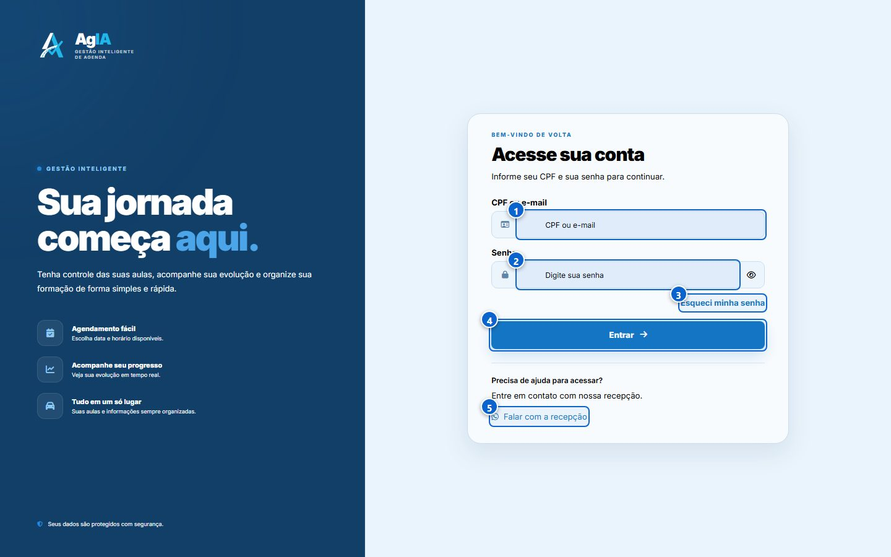

1. **CPF ou e-mail** da pessoa.
2. **Senha.** No primeiro acesso, a senha provisória é trocada por uma definitiva.
3. **Esqueci minha senha:** recebe o link por e-mail, recupera pelo celular ou pede na autoescola.
4. **Entrar:** abre o painel do perfil (Aluno, Instrutor, Recepção, Gerência ou Master).
5. **Fale com a recepção:** atalho para quem precisa de ajuda para entrar.

# Painel do Aluno

<b>Início</b>Saldo de aulas, próxima aula e progresso.

<b>Agendar aula</b>Agendamento manual e automático.

<b>Minhas aulas</b>Aulas confirmadas, realizadas, canceladas, atestados e pedidos.

<b>Meu progresso</b>Aulas, exames e provas.

<b>Mensagens</b>Conversa com a Recepção e a Gerência.

<b>Meus documentos</b>Regras das aulas e arquivos enviados pela autoescola.

<b>Meu perfil</b>Dados, curso e senha.

Conta usada: Aluno Teste Claude (categoria B, Unidade Centro de Vila Velha). Todas as telas do aluno funcionam no celular.

## Início {nova-pagina}

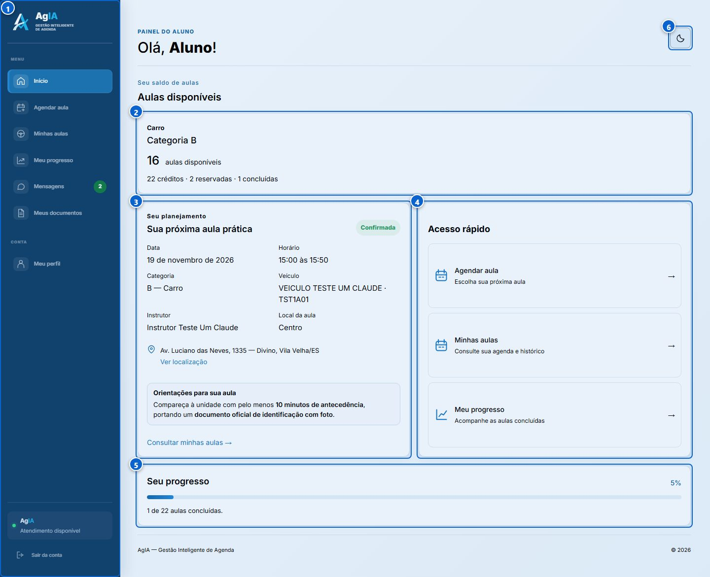

1. **Menu:** Início, Agendar aula, Minhas aulas, Meu progresso, Mensagens (com as não lidas), Meus documentos e Meu perfil.
2. **Saldo de aulas:** aulas disponíveis, créditos, reservadas e concluídas, por categoria.
3. **Próxima aula:** data, horário, instrutor, veículo, local com "Ver localização" e as orientações para o dia.
4. **Acesso rápido:** atalhos para agendar, ver as aulas e o progresso.
5. **Progresso:** quantas aulas já foram feitas do total.
6. **Tema:** alterna entre claro e escuro.

## Agendar aula (manual) {nova-pagina}

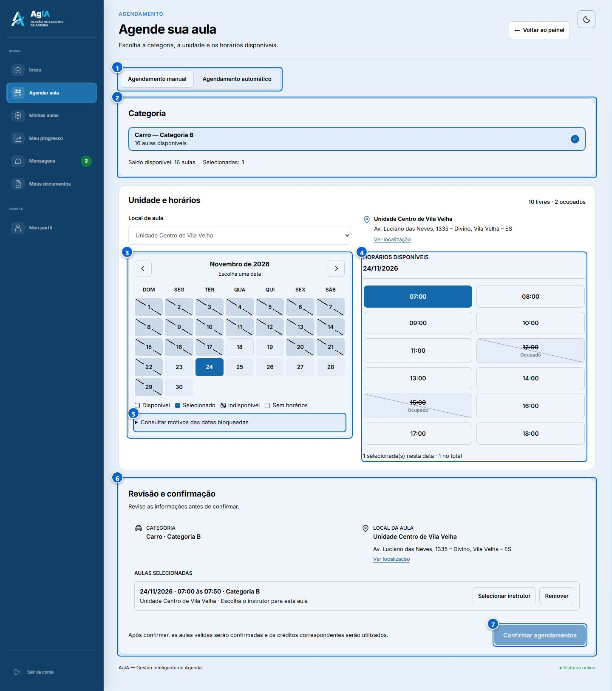

1. **Manual ou automático:** escolhe como agendar.
2. **Categoria:** moto, carro ou ônibus, com o saldo de cada uma.
3. **Calendário:** dias com horário livre; feriados e dias fechados aparecem riscados.
4. **Horários do dia:** os livres para escolher; os ocupados aparecem riscados. Dá para marcar mais de um.
5. **Motivos das datas bloqueadas:** lista por que cada data está fechada.
6. **Revisão:** confere categoria, local e as aulas escolhidas; em cada aula dá para **selecionar o instrutor** ou remover.
7. **Confirmar agendamentos:** confirma e usa os créditos. A 1ª aula exige 24 horas de antecedência e o aluno precisa estar liberado pela Recepção.

## Agendamento automático {nova-pagina}

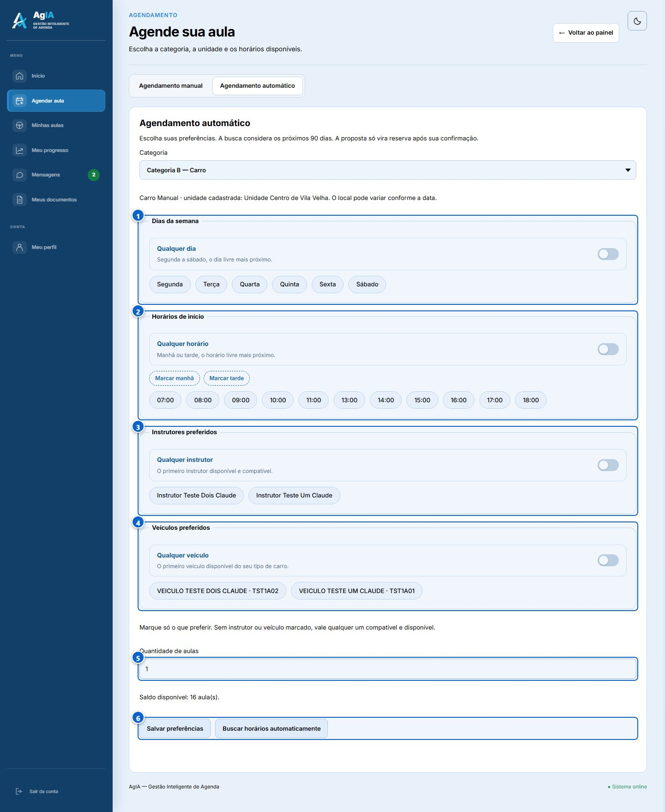

1. **Dias da semana** preferidos, ou "Qualquer dia".
2. **Horários de início** preferidos, ou "Qualquer horário" (atalhos para manhã e tarde).
3. **Instrutores preferidos**, ou "Qualquer instrutor".
4. **Veículos preferidos**, ou "Qualquer veículo" do tipo de carro do aluno.
5. **Quantidade de aulas**, com o saldo disponível.
6. **Salvar preferências** e **Buscar horários automaticamente:** o sistema procura nos próximos 90 dias e só reserva depois que o aluno confirma a proposta.

## Minhas aulas {nova-pagina}

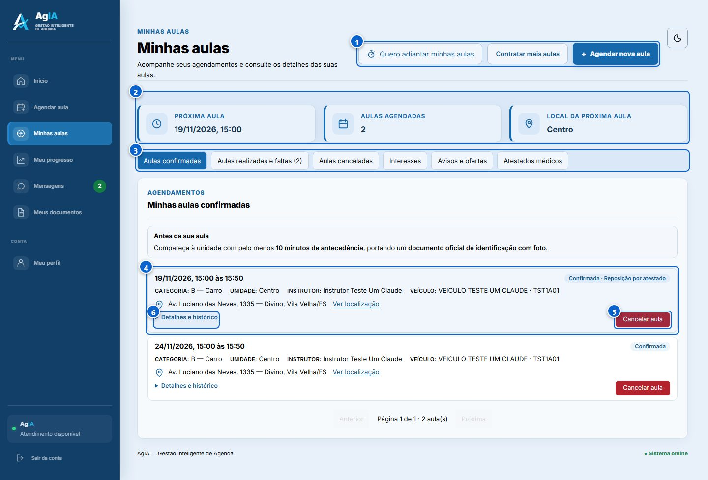

1. **Quero adiantar minhas aulas** (avisa a Recepção dos dias e horários em que pode vir antes), **Contratar mais aulas** (pede pelo chat ou WhatsApp) e **Agendar nova aula**.
2. **Resumo:** próxima aula, aulas agendadas e local da próxima aula.
3. **Abas:** confirmadas, realizadas e faltas (com avaliação da aula), canceladas (quem cancelou e por quê), interesses, avisos e ofertas, atestados médicos.
4. **Aula:** data, horário, categoria, unidade, instrutor, veículo e endereço.
5. **Cancelar aula:** escolhe o motivo; mostra se o crédito volta (no prazo) ou fica retido. Por saúde, anexa o atestado, que vai para a Recepção e a Gerência.
6. **Detalhes e histórico** da aula.

## Meu progresso {nova-pagina}

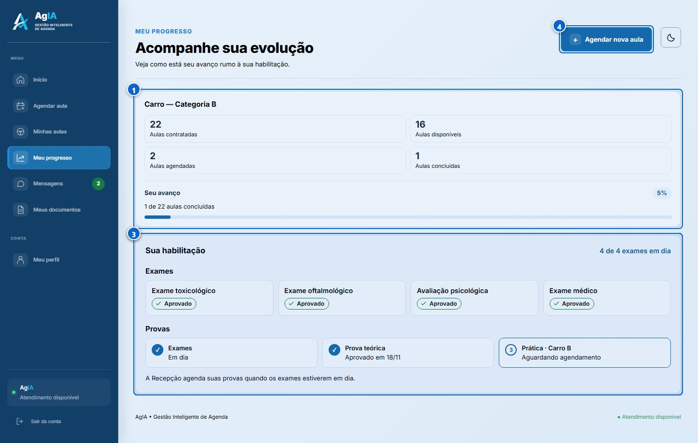

1. **Aulas da categoria:** contratadas, disponíveis, agendadas, concluídas e o percentual.
2. **Exames:** toxicológico, oftalmológico, psicológico e médico, com a situação.
3. **Provas:** teórica e práticas, com data e horário; o PDF do agendamento aparece quando a autoescola anexa.
4. **Agendar nova aula.**

## Mensagens {nova-pagina}

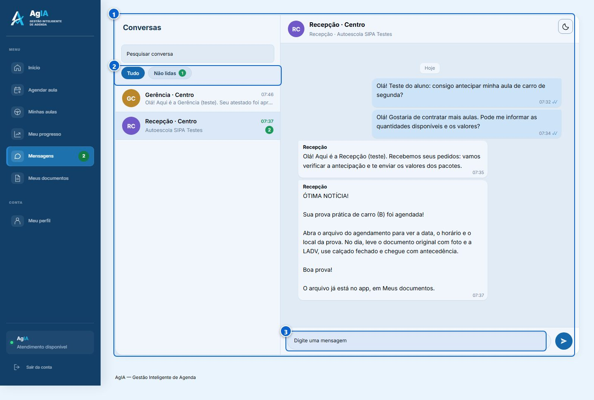

1. **Conversas:** com a Recepção e, quando ela inicia, com a Gerência.
2. **Tudo ou Não lidas.**
3. **Campo de mensagem:** o aluno pode escrever a qualquer hora.

## Meus documentos {nova-pagina}

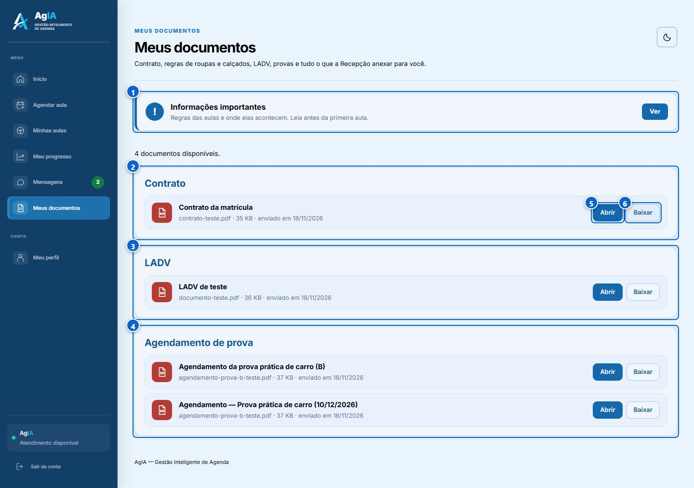

1. **Informações importantes:** regras das aulas (carro, moto, ônibus, documentos, faltas, reposição), com versão em PDF.
2. **Contrato** enviado pela autoescola.
3. **LADV.**
4. **Agendamento de prova** e outros documentos.
5. **Abrir** o documento.
6. **Baixar** o documento.

## Meu perfil {nova-pagina}

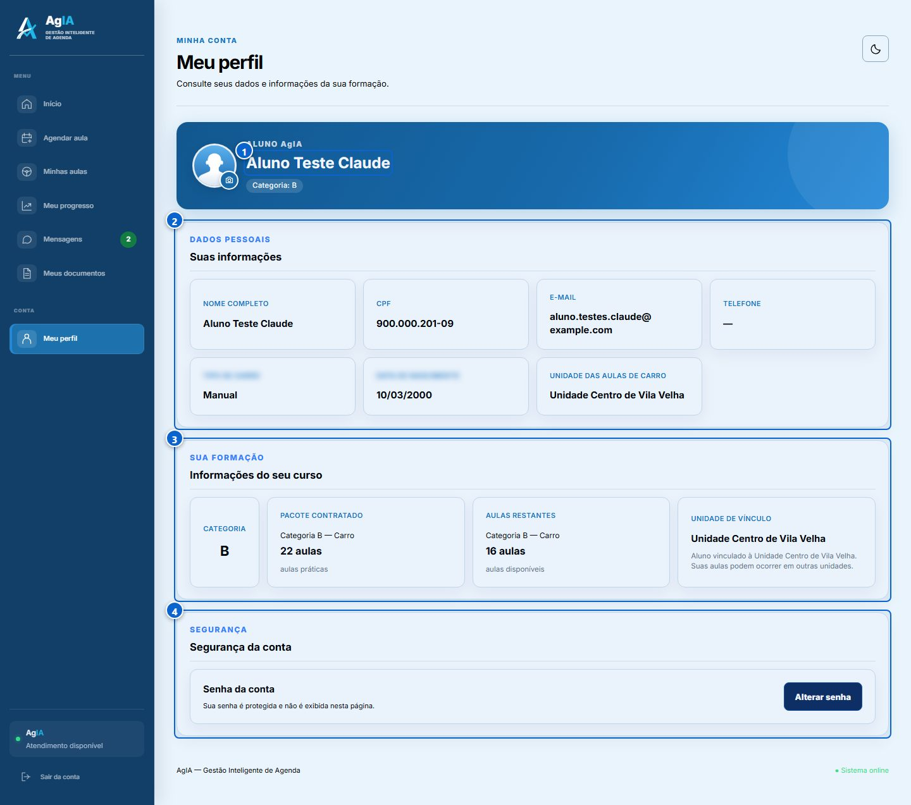

1. **Foto, nome e categoria.**
2. **Suas informações:** nome, CPF, e-mail, telefone, nascimento e unidade.
3. **Informações do curso:** categoria, pacote, aulas restantes e unidade das aulas de carro.
4. **Segurança da conta:** alterar a senha.

# Ambiente do Instrutor

<b>Início</b>Resumo do dia, desempenho e avaliações.

<b>Minha agenda</b>Aulas do dia; marca presença ou falta.

<b>Histórico</b>Aulas do dia, realizadas, faltas, período e provas.

<b>Checklist do veículo</b>Início e fim do dia, por placa.

<b>Mensagens</b>Grupo geral, Recepção e Gerência.

<b>Meu perfil</b>Dados, veículos, avaliações e senha.

Conta usada: Instrutor Teste Dois Claude (categoria B, Unidade Centro de Vila Velha, com uma aula realizada e uma falta hoje). Funciona no celular.

## Início {nova-pagina}

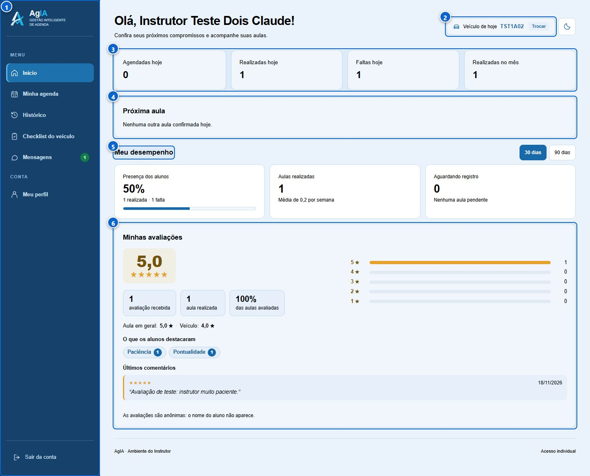

1. **Menu:** Início, Minha agenda, Histórico, Checklist do veículo, Mensagens e Meu perfil.
2. **Veículo de hoje:** a placa em uso, com **Trocar**. No 1º acesso do dia o instrutor escolhe a placa e faz o checklist.
3. **Contadores:** agendadas, realizadas e faltas de hoje e realizadas no mês.
4. **Próxima aula** do dia.
5. **Meu desempenho** em 30 ou 90 dias: presença dos alunos, aulas realizadas e aulas aguardando registro.
6. **Minhas avaliações:** nota média, estrelas, destaques e comentários dos alunos (anônimos).

## Minha agenda {nova-pagina}

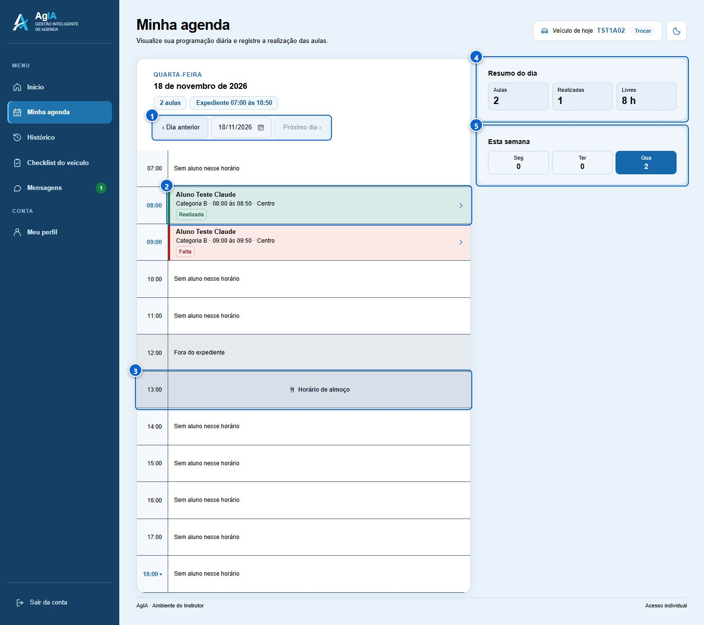

1. **Dia anterior e próximo dia** (só dias que já passaram ou hoje).
2. **Aula:** aluno, categoria, horário e local. Ao abrir, o instrutor marca **realizada** (verde) ou **falta** (vermelho).
3. **Horário de almoço.**
4. **Resumo do dia:** aulas, realizadas e horas livres.
5. **Esta semana:** aulas por dia.

## Histórico {nova-pagina}

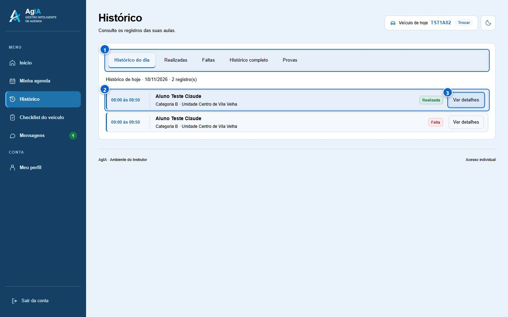

1. **Abas:** Histórico do dia, Realizadas, Faltas, Histórico completo (por mês ou período) e Provas.
2. **Registro da aula:** aluno, categoria, unidade e a situação (realizada ou falta).
3. **Ver detalhes** da aula.

## Checklist do veículo {nova-pagina}

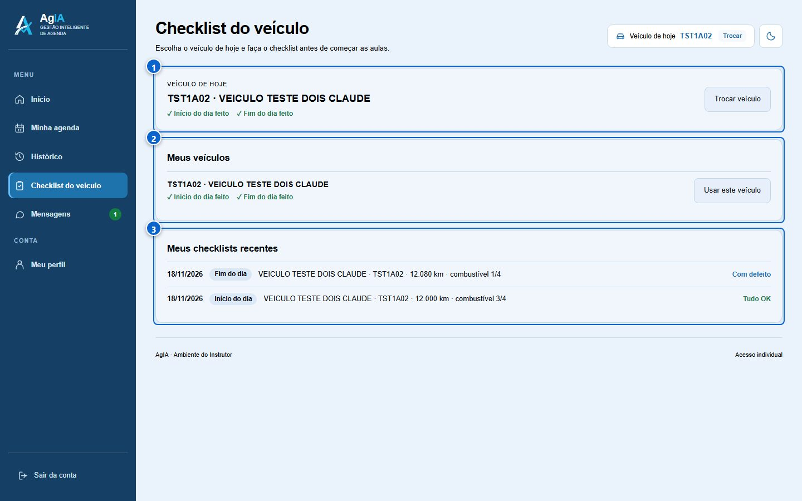

1. **Veículo de hoje:** situação do checklist (início e fim do dia) e **Trocar veículo**.
2. **Meus veículos:** os que o instrutor pode usar, com **Usar este veículo**.
3. **Checklists recentes:** data, tipo, placa, quilometragem, combustível e se estava tudo OK ou com defeito.

> **O que o checklist pede.** Início do dia: quilometragem, combustível, pneus, óleo, iluminação, limpeza, avarias, observações e até 5 fotos. Fim do dia: quilometragem, combustível, se ficou com defeito, observações e fotos. Defeito gera alerta para a Gerência.

## Mensagens {nova-pagina}

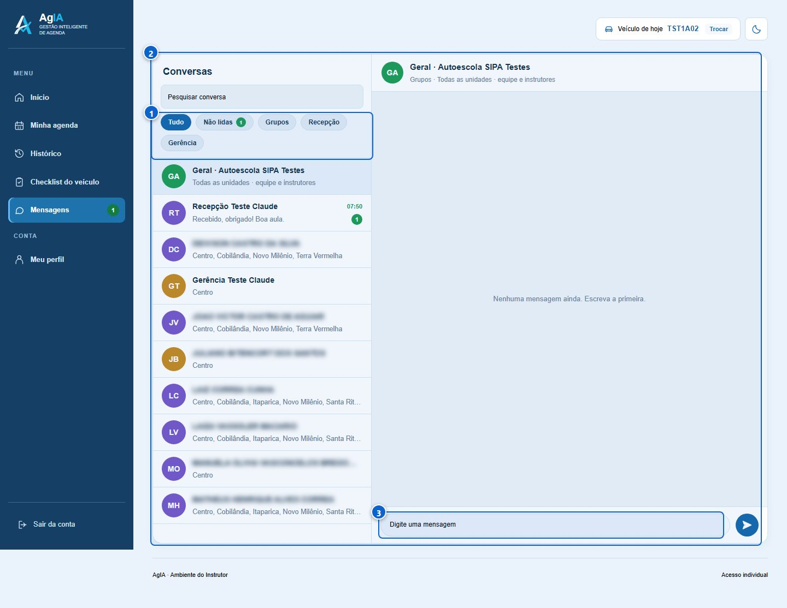

1. **Abas:** Tudo, Não lidas, Grupos, Recepção e Gerência.
2. **Conversas:** grupo geral da autoescola e conversas com a equipe.
3. **Campo de mensagem.**

## Meu perfil {nova-pagina}

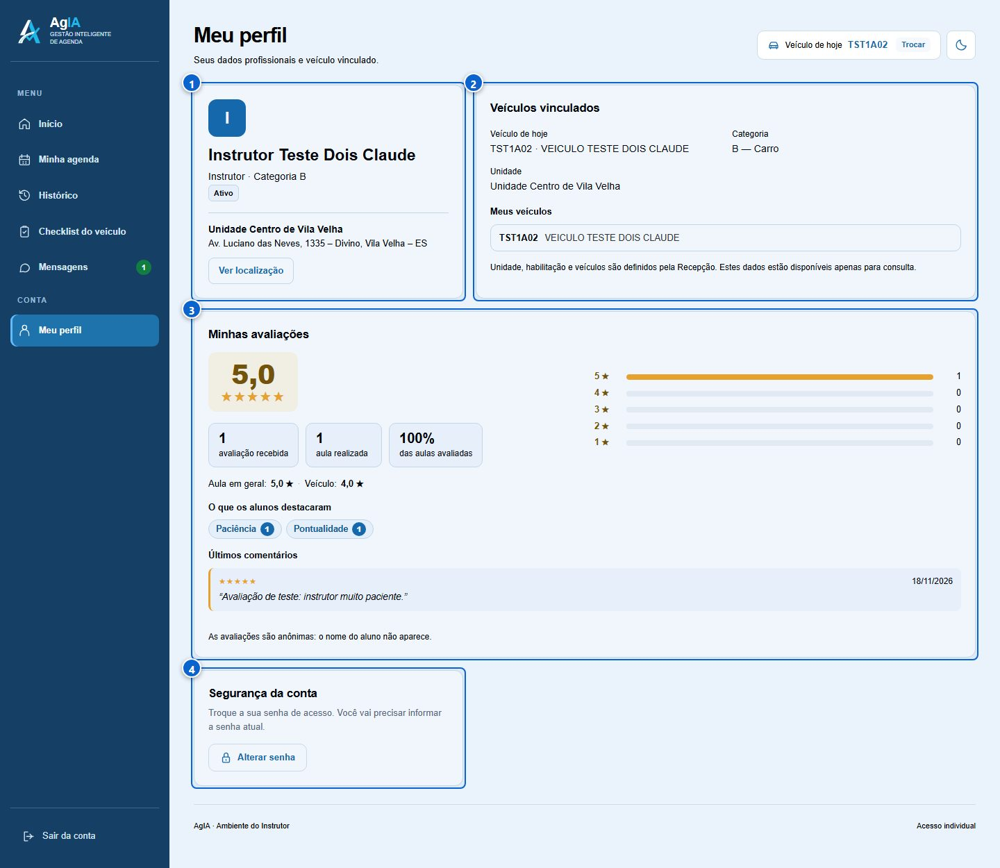

1. **Dados do instrutor:** categoria, situação, unidade e localização.
2. **Veículos vinculados:** veículo de hoje e os demais.
3. **Minhas avaliações** dos alunos.
4. **Segurança da conta:** alterar a senha.

# Recepção (ADM 1)

<b>Início</b>Indicadores, atalhos e solicitações à Gerência.

<b>Alunos</b>Lista, cadastro e ficha do aluno.

<b>Agendas</b>Agenda por instrutor, agendar e realocar.

<b>Provas</b>Dias de prova com instrutor e veículo.

<b>Instrutores</b>Lista, detalhes e cadastro.

<b>Veículos e recursos</b>Lista, detalhes, manutenção e cadastro.

<b>Verificações</b>Atestados enviados pelos alunos.

<b>Antecipação de aulas</b>Alunos que querem adiantar.

<b>Mensagens</b>Chat com alunos, equipe e instrutores.

<b>Lançamento no SIT</b>Aulas para lançar no Detran.

<b>Meu perfil</b>Dados e senha.

Conta usada: Recepção Teste Claude, Unidade Centro de Vila Velha. A Recepção vê só a sua unidade.

## Início {nova-pagina}

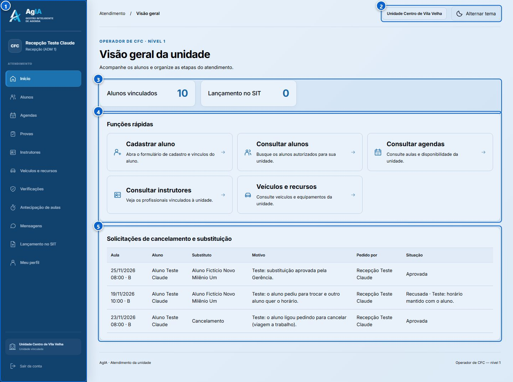

1. **Menu** da Recepção.
2. **Unidade** em atendimento e botão de **tema**.
3. **Indicadores:** alunos vinculados e aulas pendentes de lançamento no SIT.
4. **Funções rápidas:** cadastrar aluno, consultar alunos, agendas, instrutores e veículos.
5. **Solicitações de cancelamento e substituição** que a Recepção pediu e a resposta da Gerência (aprovada ou recusada).

## Alunos {nova-pagina}

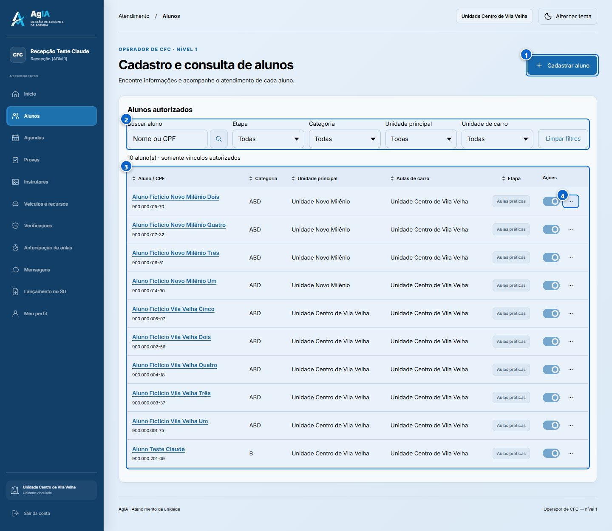

1. **Cadastrar aluno:** nome, CPF, nascimento, telefone, e-mail, categoria, quantidade de aulas, tipo de CNH (CNH Brasil ou Social), data do contrato e contrato assinado.
2. **Busca e filtros:** nome ou CPF, etapa, categoria, unidade principal e unidade de carro.
3. **Lista:** categoria, unidades, aulas de carro, etapa e a chave que **libera o aluno para agendar**.
4. **⋯ Ações:** Visualizar (abre a ficha), Editar e Enviar mensagem.

## Ficha do aluno {nova-pagina}

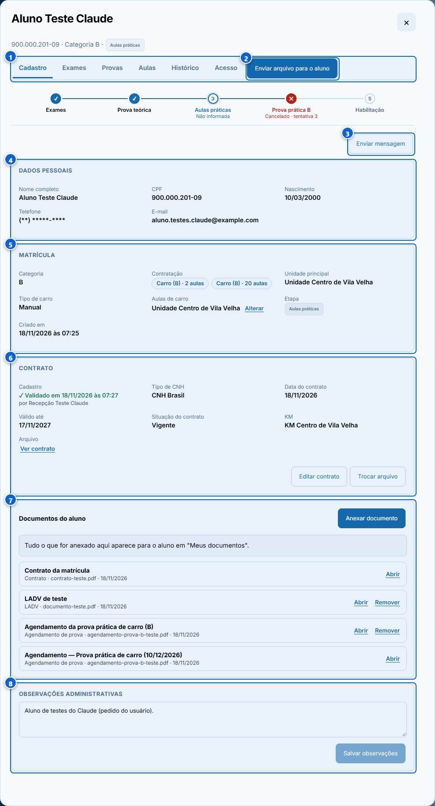

1. **Abas:** Cadastro, **Exames** (exames, LADV e liberação para aulas práticas), **Provas** (tentativas e resultado), **Aulas** (saldo, contratar pacote, aulas avulsas), **Histórico** e **Acesso** (link de nova senha).
2. **Enviar arquivo para o aluno:** agendamento de prova, resultado, LADV, contrato e outros; vai para "Meus documentos" do aluno.
3. **Enviar mensagem** ao aluno.
4. **Etapas e dados pessoais**, com Alterar.
5. **Matrícula:** categoria, aulas contratadas, unidade, tipo de carro e local das aulas.
6. **Contrato:** data, validade de 12 meses, Ver e Editar contrato.
7. **Documentos do aluno:** anexar, abrir e remover.
8. **Observações administrativas.**

## Agendas {nova-pagina}

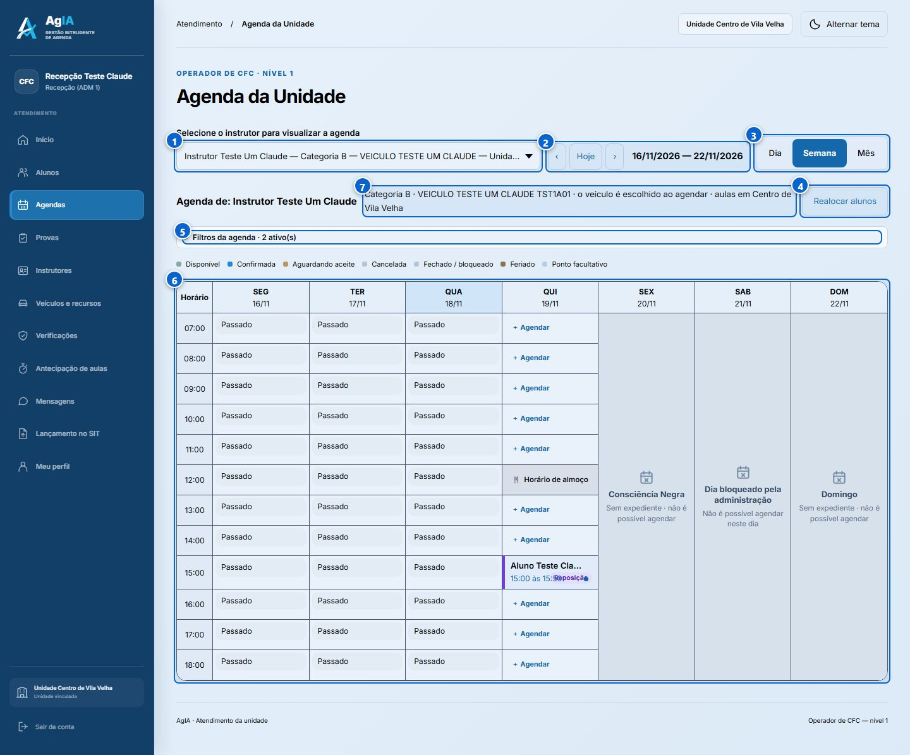

1. **Instrutor:** escolhe de quem é a agenda.
2. **Navegação:** semana anterior, hoje e próxima.
3. **Dia, Semana ou Mês.**
4. **Realocar alunos:** passa as aulas de um período para outro instrutor ou veículo, mostrando antes os conflitos.
5. **Filtros** (situação e data).
6. **Aula agendada:** clique para ver os detalhes e as ações.
7. **+ Agendar:** marca aula num horário livre, escolhendo o veículo e o aluno.

## Detalhes da aula {nova-pagina}

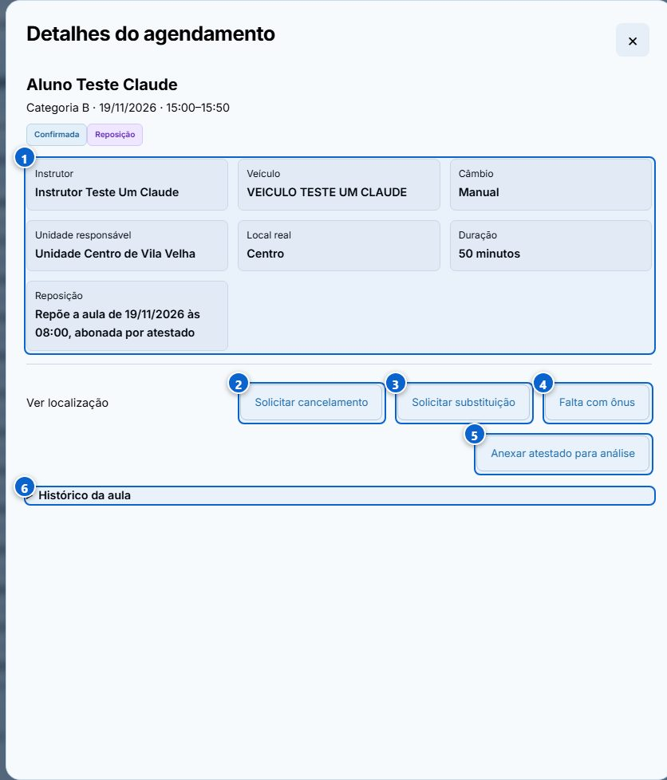

1. **Dados da aula:** instrutor, veículo, câmbio, unidade, local, duração e se é reposição.
2. **Solicitar cancelamento:** a Recepção pede, a Gerência decide.
3. **Solicitar substituição** de aluno: também decidida pela Gerência.
4. **Falta com ônus:** o aluno perde o crédito e o horário é liberado.
5. **Anexar atestado para análise.**
6. **Histórico da aula.**

## Provas {nova-pagina}

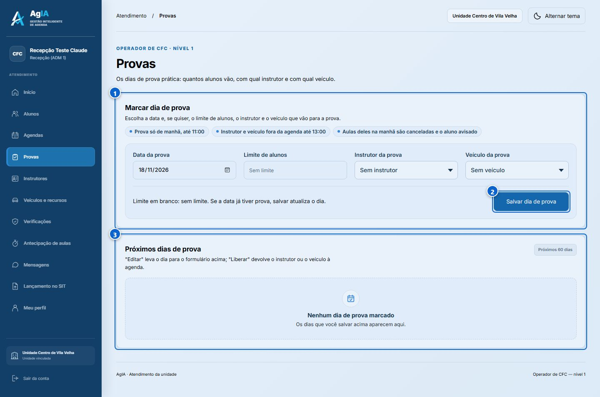

1. **Marcar dia de prova:** data, limite de alunos, instrutor e veículo da prova (o veículo fica reservado só naquele dia).
2. **Salvar dia de prova.**
3. **Próximos dias de prova** com os alunos marcados. A prova de cada aluno é marcada na ficha dele.

## Instrutores {nova-pagina}

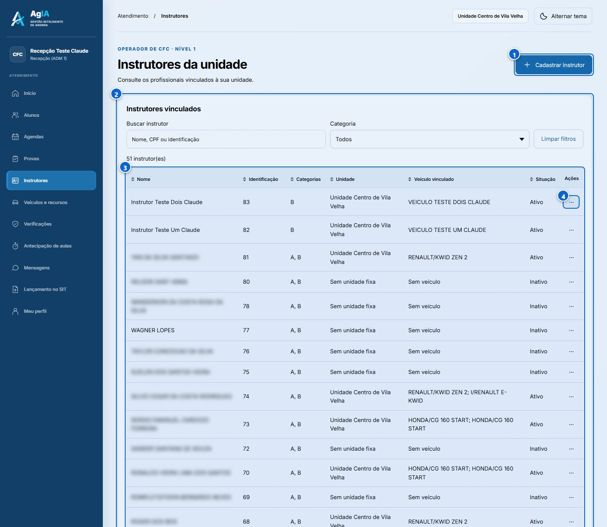

1. **Cadastrar instrutor:** nome, identificação, categoria e CPF; unidade, e-mail, telefone e veículos são opcionais; horário de almoço.
2. **Busca e filtro** por categoria.
3. **Lista:** identificação, categorias, unidade, veículo vinculado e situação.
4. **⋯ Ações:** Visualizar (desempenho, histórico de aulas, checklists de 30 dias, realocar alunos) e Editar.

## Veículos e recursos {nova-pagina}

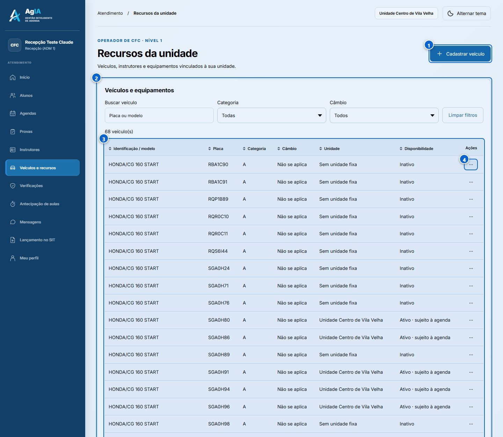

1. **Cadastrar veículo:** modelo, placa e categoria.
2. **Busca e filtros:** categoria e câmbio.
3. **Lista:** placa, categoria, câmbio, unidade e disponibilidade.
4. **⋯ Ações:** Visualizar (vínculo, horários, **status e manutenção** — ativo, reserva, preventiva ou reativa — histórico de manutenções, checklists) e Editar.

## Verificações {nova-pagina}

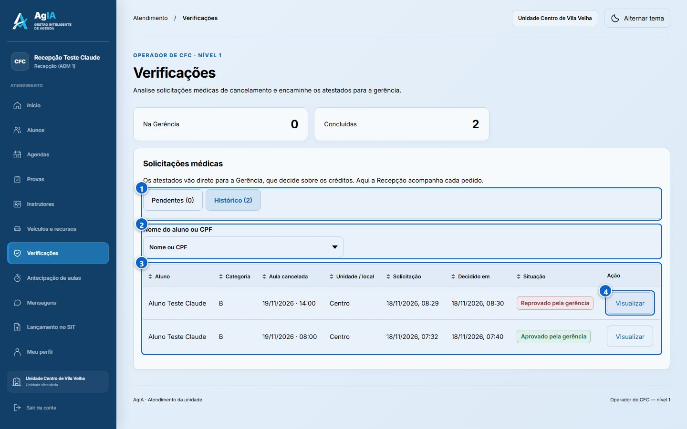

1. **Pendentes e Histórico** dos atestados.
2. **Busca** por aluno ou CPF.
3. **Lista:** aluno, categoria, aula, unidade, data e situação (em análise, aprovado ou reprovado).
4. **Visualizar:** a Recepção confere o documento e **encaminha para a Gerência**, que decide. A Recepção só acompanha.

## Antecipação de aulas {nova-pagina}

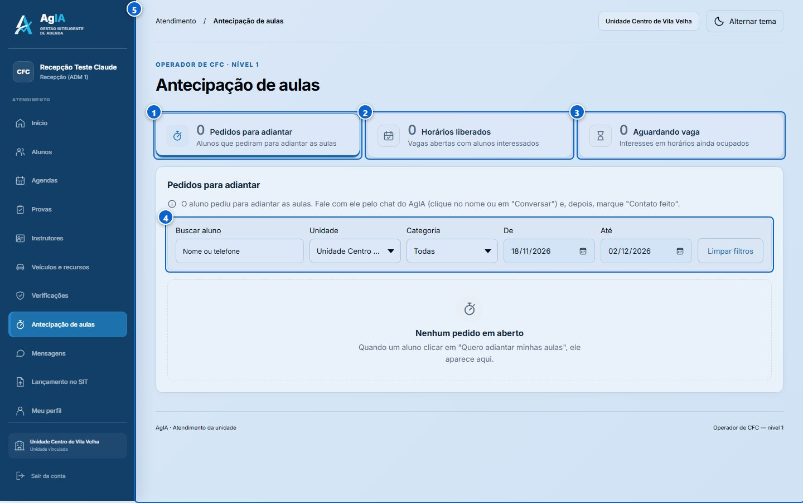

1. **Pedidos para adiantar:** alunos que pediram para fazer aula antes.
2. **Horários liberados:** vagas que abriram com alunos interessados.
3. **Aguardando vaga:** interesses em horários ainda ocupados.
4. **Filtros:** aluno, unidade, categoria e período.
5. **Aluno da lista:** a Recepção conversa com ele e remarca.

## Mensagens {nova-pagina}

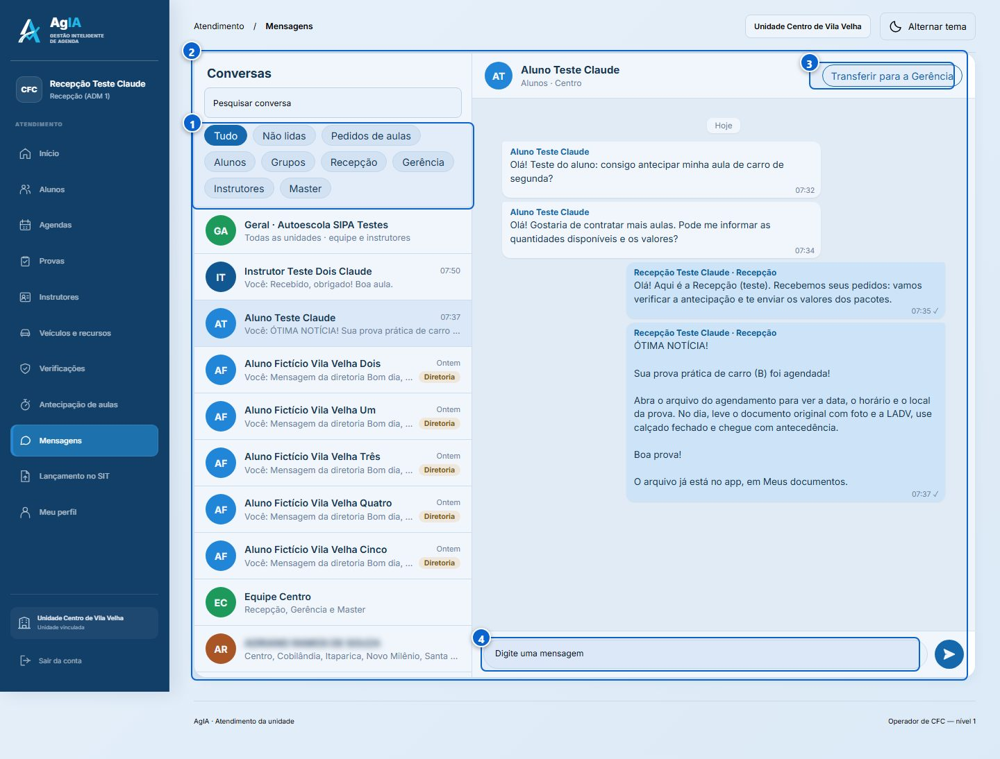

1. **Abas:** Tudo, Não lidas, **Pedidos de aulas** (alunos que pediram mais aulas, com "Contato feito"), Alunos, Grupos, Recepção, Gerência, Instrutores e Master.
2. **Conversas** com alunos, equipe e instrutores, e o grupo da unidade.
3. **Transferir para a Gerência** a conversa com o aluno.
4. **Campo de mensagem:** a resposta aparece como "Nome · Cargo".

## Lançamento no SIT {nova-pagina}

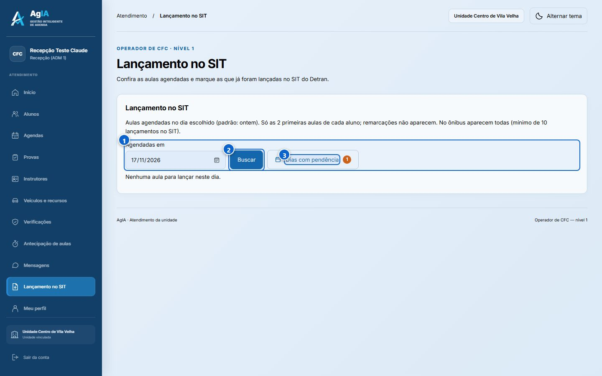

1. **Data** das aulas agendadas.
2. **Buscar** as aulas que precisam ser lançadas no SIT do Detran (as duas primeiras do agendamento inicial).
3. **Dias com pendência:** calendário dos dias que ainda têm aula para lançar. Cada aula é marcada como "Lançado no SIT".

## Meu perfil {nova-pagina}

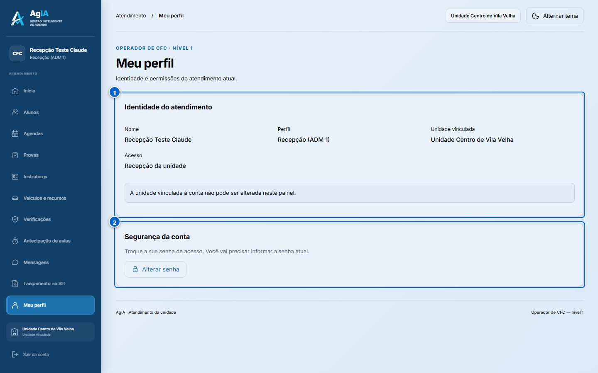

1. **Identidade do atendimento:** nome, cargo e unidade.
2. **Segurança da conta:** alterar a senha.

# Gerência (ADM 2)

A Gerência tem **todas as telas da Recepção** na sua unidade. Abaixo estão só as telas que mudam ou que são só dela.

<b>Início da Gerência</b>Indicadores para decisão e aprovação das solicitações.

<b>Agendas</b>Consulta geral, dia sem aula, cancelar e substituir.

<b>Verificações</b>Decide os atestados.

<b>Relatórios</b>Aulas, cancelamentos, atestados, marketing e avaliações.

<b>Controle de veículos</b>Frota, checklists e registro de ações.

<b>Ficha do aluno</b>Corrigir registro de prova e vínculo do aluno.

Conta usada: Gerência Teste Claude, Unidade Centro de Vila Velha.

## Início da Gerência {nova-pagina}

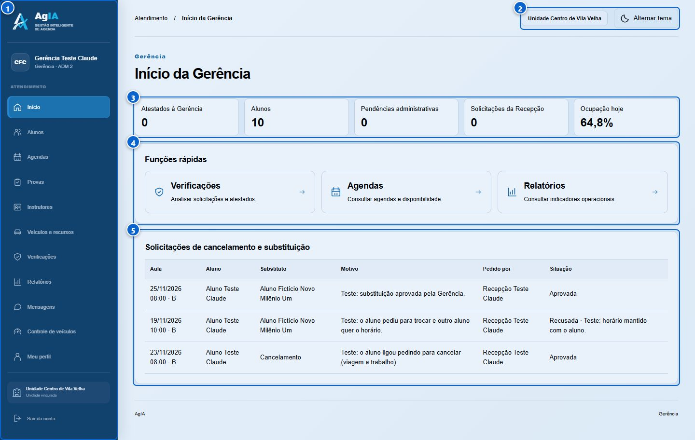

1. **Menu** da Gerência (com Relatórios e Controle de veículos).
2. **Unidade** e tema.
3. **Indicadores:** atestados à Gerência, alunos, pendências, solicitações da Recepção e ocupação de hoje.
4. **Funções rápidas:** Verificações, Agendas e Relatórios.
5. **Solicitações da Recepção** de cancelamento e substituição, para **aprovar ou recusar**.

## Agendas {nova-pagina}

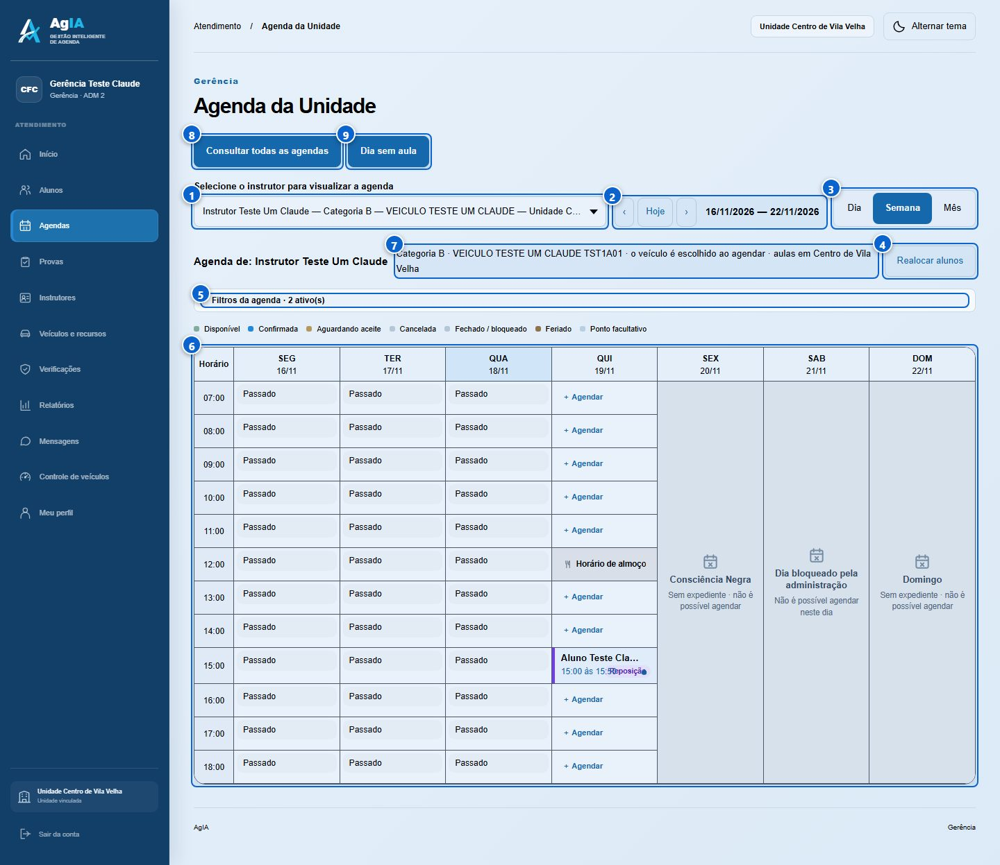

1-7. **Iguais aos da Recepção:** instrutor, navegação, dia/semana/mês, realocar, filtros, aula e agendar.
8. **Consultar todas as agendas:** consulta com filtros combinados (unidade, categoria, aluno, tipo de CNH, instrutor, veículo, situação do veículo, período e horário).
9. **Dia sem aula:** fecha um ou vários dias (sem expediente, reunião, feriado municipal, manutenção) e pode cancelar as aulas marcadas devolvendo o crédito e avisando o aluno.

## Detalhes da aula {nova-pagina}

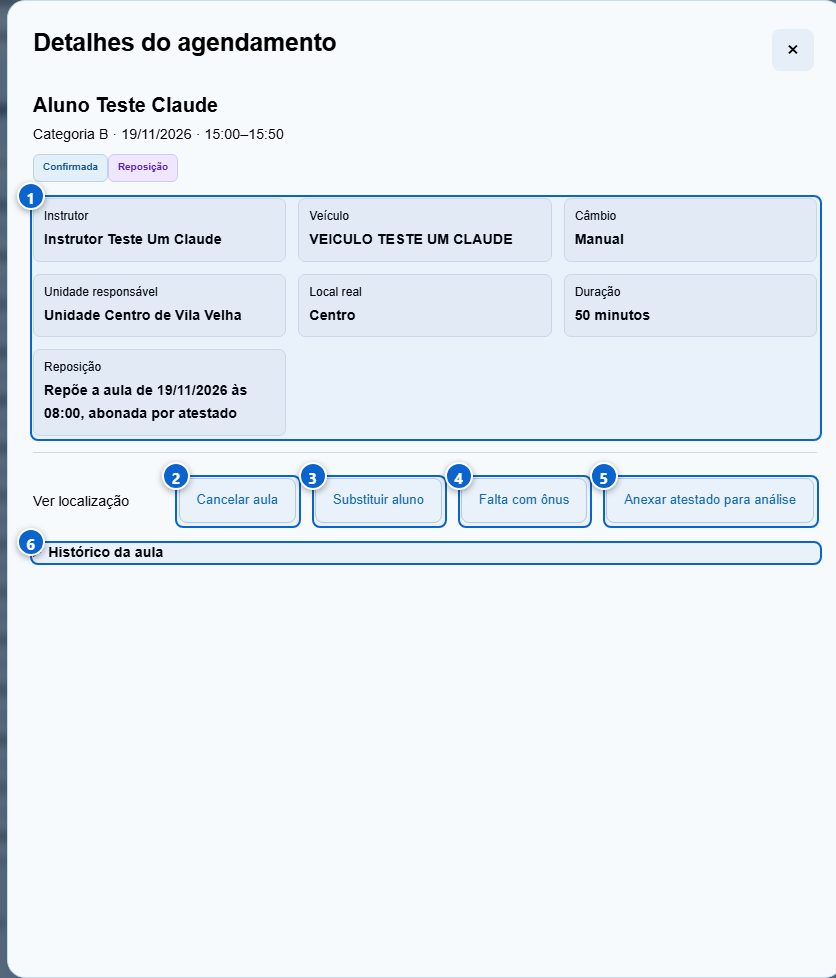

1. **Dados da aula.**
2. **Cancelar aula:** direto, com motivo; só a Gerência e o Master cancelam.
3. **Substituir aluno:** coloca outro aluno no horário (mesmo instrutor e veículo) e decide se o crédito de quem saiu volta ou fica retido.
4. **Falta com ônus.**
5. **Anexar atestado para análise.**
6. **Histórico da aula.**

## Verificações {nova-pagina}

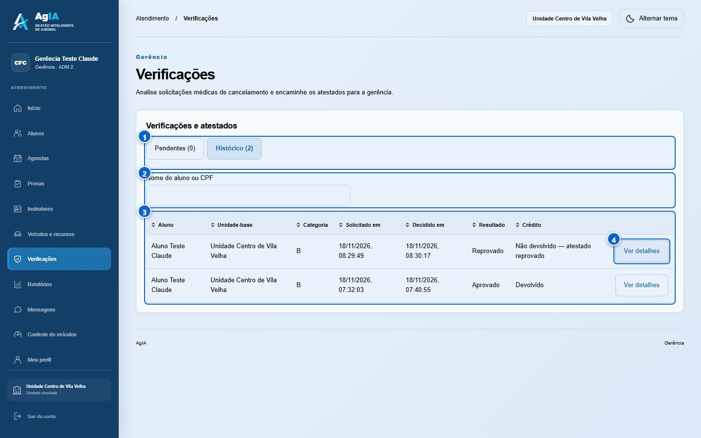

1. **Pendentes e Histórico.**
2. **Busca** por aluno ou CPF.
3. **Lista** dos atestados que a Recepção conferiu.
4. **Ver detalhes:** a Gerência vê as aulas do aluno no período do atestado e **escolhe as aulas abonadas**; elas são canceladas e o crédito volta para o aluno reagendar.

## Relatórios {nova-pagina}

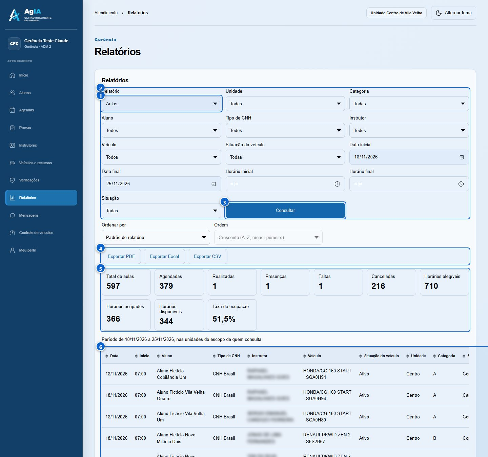

1. **Relatório:** Aulas, Instrutores, Veículos e ocupação, Cancelamentos, Cancelamentos por motivo, Aulas por aluno, Atestados, Comparativo entre unidades, Distribuição por dia, Devoluções e decisões, e os de marketing (**finalizaram as aulas**, **prova agendada** e **reprovados**).
2. **Filtros:** unidade, categoria, aluno, tipo de CNH, instrutor, veículo, situação do veículo, período, horário, situação e ordenação.
3. **Consultar.**
4. **Exportar** em PDF, Excel ou CSV.
5. **Indicadores** do resultado: agendadas, realizadas, presenças, faltas, canceladas e ocupação.
6. **Tabela** do relatório. Mais abaixo ficam as **avaliações dos alunos** por instrutor, por veículo e no período.

## Controle de veículos {nova-pagina}

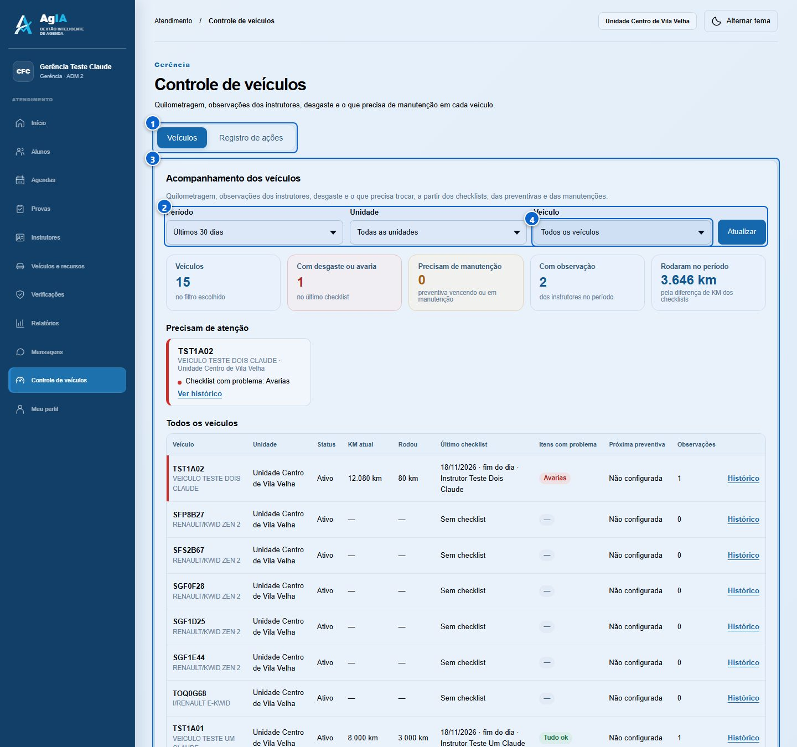

1. **Veículos ou Registro de ações** (quem agendou, cancelou ou alterou cada aula).
2. **Filtros:** período (7, 30 ou 90 dias), unidade e veículo.
3. **Precisam de atenção:** veículos com defeito, avaria ou preventiva vencida.
4. **Todos os veículos:** quilometragem, quanto rodou, último checklist, problemas e próxima preventiva, com Ver histórico.

## Ficha do aluno: provas {nova-pagina}

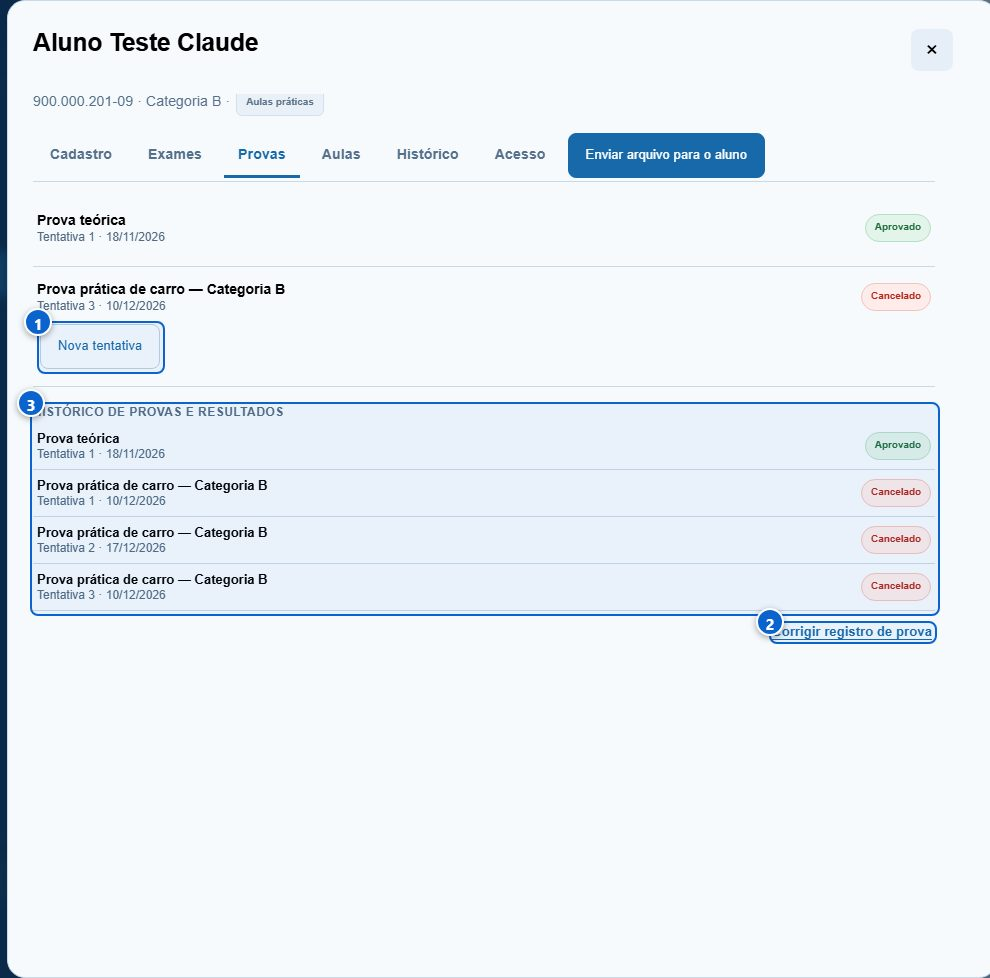

1. **Nova tentativa** de prova.
2. **Corrigir registro de prova:** data, situação e resultado de cada tentativa (só Gerência e Master). O resultado só é aceito a partir do dia da prova.
3. **Histórico de provas e resultados.**

> Na aba Cadastro da ficha, a Gerência também tem **Vínculo e situação cadastral** do aluno. Em Provas (menu), pode **excluir** um dia de prova vazio.

# Master (ADM 3)

O Master tem **tudo da Gerência em todas as unidades** e mais as telas abaixo.

<b>Visão global</b>Indicadores de todas as unidades ou de uma.

<b>Unidades</b>Agendas e bloqueios de cada unidade.

<b>Gestão de acessos</b>Contas da equipe: criar, editar, redefinir e excluir.

<b>Meu perfil</b>Unidades que acessa e senha.

Conta usada: Master de Testes (Claude).

## Visão global {nova-pagina}

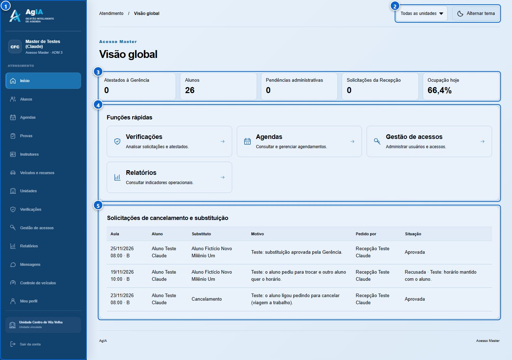

1. **Menu** do Master (com Unidades e Gestão de acessos).
2. **Todas as unidades** ou uma unidade: escolhe o que ver em todas as telas.
3. **Indicadores** de todas as unidades.
4. **Funções rápidas:** Verificações, Agendas, Gestão de acessos e Relatórios.
5. **Solicitações** de cancelamento e substituição.

## Unidades {nova-pagina}

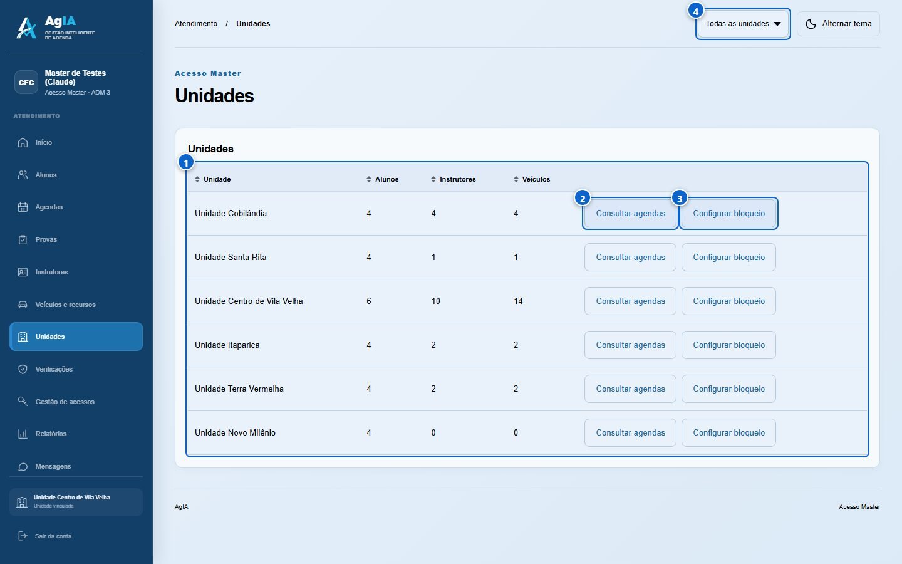

1. **Unidades:** alunos, instrutores e veículos de cada uma.
2. **Consultar agendas** da unidade.
3. **Configurar bloqueio:** fecha a unidade numa data (feriado, recesso, dia fechado), com justificativa.
4. **Unidade no topo:** todas ou uma.

## Gestão de acessos {nova-pagina}

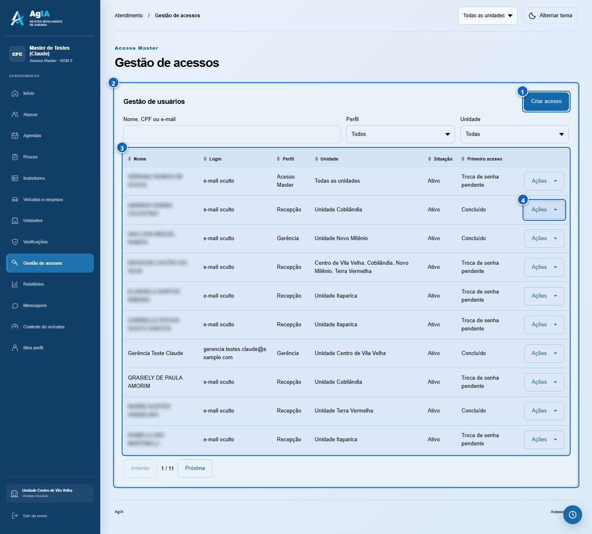

1. **Criar acesso:** conta de Recepção (ADM 1) ou Gerência (ADM 2), com nome, e-mail, unidade e justificativa.
2. **Filtros:** nome, CPF ou e-mail, perfil e unidade.
3. **Lista:** login, perfil, unidade, situação e primeiro acesso (troca de senha pendente ou concluída).
4. **Ações:** Editar (dados, unidade, conta ativa, alterar perfil), Redefinir acesso (link de nova senha) e Excluir perfil.

## Meu perfil {nova-pagina}

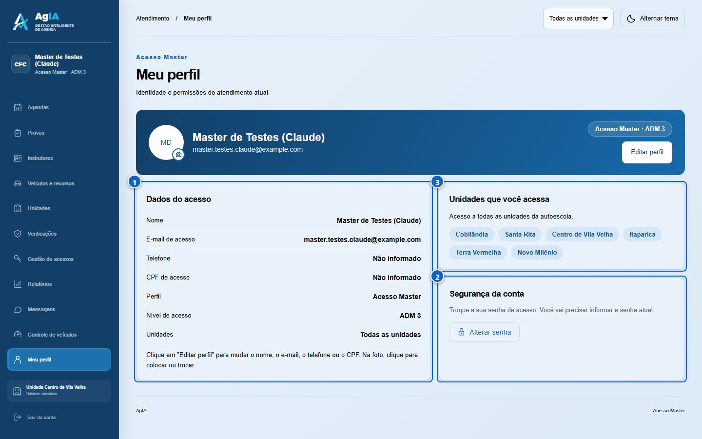

1. **Dados do acesso:** nome, e-mail, perfil e nível.
2. **Segurança da conta:** alterar a senha.
3. **Unidades que você acessa.**

# Pedidos da KM e onde estão no sistema

A tabela compara os pedidos de evolução da KM com o que existe hoje. **OK** quer dizer que a função está no sistema e foi testada com as contas de teste; **Decidir** quer dizer que depende de uma decisão da KM.

## Agenda e equipamentos

| Pedido | Onde ver | Situação |
|---|---|---|
| Filtros por equipamento, unidade e instrutor | Agendas › Consultar todas as agendas; Relatórios | OK |
| Status ativo, reserva, manutenção preventiva e reativa | Veículos e recursos › detalhes do veículo › Status e manutenção | OK |
| Previsão e acompanhamento de manutenção | Detalhes do veículo (preventiva por dias ou KM, programada, reativa com previsão, histórico); Controle de veículos | OK |
| Realocação de veículos | Agendas › Realocar alunos (veículo substituto) | OK |
| Realocação de instrutores | Agendas › Realocar alunos (instrutor substituto) | OK |
| Substituição de aluno em horário agendado | Agendas › aula › Substituir aluno (Gerência) ou Solicitar substituição (Recepção) | OK |
| Agendamento automático com qualquer veículo e instrutor | Aluno › Agendar aula › Agendamento automático | OK |
| Reserva de veículos para provas | Provas › Marcar dia de prova (veículo reservado só no dia) | OK |

## Gerência

| Pedido | Onde ver | Situação |
|---|---|---|
| Comprovante de agendamento de prova em PDF | Ficha › Enviar arquivo para o aluno; aluno baixa em Meu progresso e Meus documentos | OK |
| Relatório de alunos que concluíram as aulas | Relatórios › Marketing: alunos que finalizaram as aulas | OK |
| Relatório de alunos com prova agendada | Relatórios › Marketing: alunos com prova agendada | OK |
| Relatório de alunos reprovados | Relatórios › Marketing: alunos reprovados | OK |
| Chat interno | Mensagens (grupos, conversas individuais, não lidas) | OK |
| Cancelamento de aulas só pela Gerência | Agendas › aula › Cancelar aula (a Recepção só solicita) | OK |
| Aprovação e rejeição de atestados | Verificações (Gerência decide) | OK |
| Gerenciamento de substituições | Início da Gerência › Solicitações; Agendas › Substituir aluno | OK |

## Recepção

| Pedido | Onde ver | Situação |
|---|---|---|
| Validar o aluno antes de liberar o agendamento | Ficha › Cadastro (validação) e Exames (liberação para aulas práticas) | OK |
| Conferir os primeiros agendamentos no SIT | Lançamento no SIT | OK |
| Transferir a agenda na falta de instrutor ou veículo | Agendas › Realocar alunos | OK |
| Falta com ônus | Agendas › aula › Falta com ônus | OK |
| Acompanhar atestados sem decidir | Verificações (encaminha e acompanha) | OK |

## Aluno

| Pedido | Onde ver | Situação |
|---|---|---|
| 24 horas de antecedência no primeiro agendamento | Agendar aula (manual e automático) | OK |
| Modalidade CNH Brasil, CNH Social, Cortesia ou Permuta | Cadastrar aluno (Cortesia e Permuta só pelo Master); filtro em Relatórios | OK |
| Falta e reposição por atestado | Cancelar aula por saúde; Minhas aulas › Atestados médicos | OK |
| Chat em horário comercial | Mensagens do aluno | Decidir |
| Pedir mais aulas | Minhas aulas › Contratar mais aulas; Recepção › Mensagens › Pedidos de aulas | OK |
| Campo de LADV | Ficha › Exames › LADV | OK |
| Liberação do agendamento depois das etapas obrigatórias | Ficha › Cadastro (etapas) e Exames (liberação) | OK |
| Data do contrato, validade de 12 meses e anexo | Cadastrar aluno; Ficha › Contrato | OK |
| Avaliação de aula, instrutor e veículo por estrelas | Minhas aulas › Avaliar; Relatórios › Avaliações; Instrutores | OK |

## Instrutor

| Pedido | Onde ver | Situação |
|---|---|---|
| Identificar o veículo do dia pela placa | Topo › Veículo de hoje | OK |
| Checklist obrigatório por instrutor, placa e data | Checklist do veículo | OK |
| Quilometragem, pneus, combustível, iluminação, óleo, limpeza | Checklist do início do dia | OK |
| Avarias, observações e fotos | Checklist (início e fim do dia) | OK |

# Pontos para decidir

Estes pontos não são erros: as funções existem, mas falta a KM decidir como quer que funcionem.

1. **Cadastro de pacotes:** o sistema já guarda pacotes de aulas, mas **ainda não há tela para cadastrá-los**. Por isso, na ficha do aluno, "Contratar pacote" avisa que não há pacote. Hoje as aulas extras entram por **Adicionar aulas avulsas**. Decidir se a KM quer a tela de pacotes (com nome, quantidade de aulas e categoria).
2. **"Tenho interesse" em horário ocupado:** o botão saiu do agendamento do aluno em 16/11. A parte da Antecipação de aulas que depende dele (Aguardando vaga, Horários liberados e a oferta de horário ao aluno) só mostra os interesses antigos. Decidir se o botão volta ou se essa parte da Antecipação sai.
3. **Horário do chat do aluno:** o pedido original era limitar o chat do aluno ao horário comercial. Em 09/11 ficou decidido que o aluno pode escrever **a qualquer hora**, e é assim que funciona hoje. Confirmar se fica assim.

> Situação dos testes em 18/11/2026: todas as telas deste guia foram abertas com as contas de teste. Os testes automáticos do sistema passaram: API 1630 de 1630 e telas 318 de 318.
